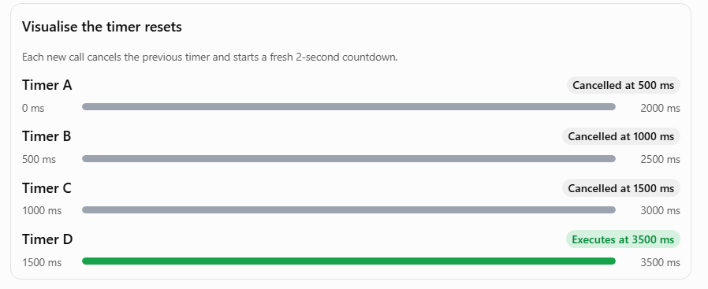

# JavaScript Debounce – Complete Explanation

## 1. What is Debouncing?

**Debouncing** ensures that a function executes only after a specified amount of time has passed since its last invocation.

If the function is called repeatedly, the timer keeps resetting. The function executes only when calls stop for the specified duration.

### Real-world example: Search input

Imagine a user typing into a search box:

```text
J → Ja → Jav → Java → JavaScript
```

Without debouncing, an API request could be made for every keystroke.

With a 500ms debounce, the API request happens only after the user stops typing for 500ms.

This reduces unnecessary API calls.

---

## 2. Basic Debounce Implementation

```javascript
function debounce(callback, delay) {
  let timerId;

  return function (...args) {
    clearTimeout(timerId);

    timerId = setTimeout(() => {
      callback.apply(this, args);
    }, delay);
  };
}
```

### Understanding the implementation

| Code                                 | Responsibility                                                                |
| ------------------------------------ | ----------------------------------------------------------------------------- |
| `function debounce(callback, delay)` | Accepts the original function and the delay.                                  |
| `let timerId`                        | Stores the ID of the currently scheduled timer.                               |
| `return function (...args)`          | Returns a new function that will be called instead of the original function.  |
| `clearTimeout(timerId)`              | Cancels the previously scheduled timer, if it hasn't executed.                |
| `setTimeout()`                       | Creates a new timer.                                                          |
| `callback.apply(this, args)`         | Executes the original function with the correct `this` context and arguments. |

---

## 3. What Exactly Are `args`?

In this implementation:

```javascript
return function (...args) {
  clearTimeout(timerId);

  timerId = setTimeout(() => {
    callback.apply(this, args);
  }, delay);
};
```

`args` represents all the arguments passed to the returned function.

The `...args` syntax is called a **rest parameter**. It collects individual arguments into an array.

### Example

```javascript
function searchAPI(searchText, category) {
  console.log(searchText, category);
}

const debouncedSearch = debounce(searchAPI, 500);

debouncedSearch("JavaScript", "Programming");
```

When we call:

```javascript
debouncedSearch("JavaScript", "Programming");
```

JavaScript collects the arguments into:

```javascript
args = ["JavaScript", "Programming"];
```

After the timer expires:

```javascript
callback.apply(this, args);
```

This is equivalent to:

```javascript
searchAPI("JavaScript", "Programming");
```

### Why use `args`?

Because debounce should be reusable with functions that accept:

- One argument
- Two arguments
- Multiple arguments

We don't need to know the number of arguments in advance.

---

## 4. Understanding `callback.apply(this, args)`

The `apply()` method invokes a function with:

1. A specified `this` context.
2. An array of arguments.

Syntax:

```javascript
callback.apply(thisArg, argsArray);
```

Example:

```javascript
function greet(name, message) {
  console.log(`${message}, ${name}`);
}

greet.apply(null, ["Alex", "Hello"]);

// Output:
// Hello, Alex
```

In our debounce implementation:

```javascript
callback.apply(this, args);
```

- `callback` is the original function.
- `this` preserves the calling context.
- `args` contains the arguments passed to the debounced function.

---

## 5. Example – Search Input

```javascript
function debounce(callback, delay) {
  let timerId;

  return function (...args) {
    clearTimeout(timerId);

    timerId = setTimeout(() => {
      callback.apply(this, args);
    }, delay);
  };
}

function searchAPI(searchText) {
  console.log("API called with:", searchText);
}

const debouncedSearch = debounce(searchAPI, 500);

// Simulate user typing
debouncedSearch("J");
debouncedSearch("Ja");
debouncedSearch("Jav");
debouncedSearch("Java");
debouncedSearch("JavaScript");
```

### Expected output

```text
(After 500ms from the last call)

API called with: JavaScript
```

Only the last invocation executes because each new call cancels the previous timer.

---

## 6. Step-by-Step Execution

Let's use a 2-second delay so that we can clearly understand how the timer behaves.

```javascript
function debounce(callback, delay) {
  let timerId;

  return function (...args) {
    console.log("Debounced function called with:", args);

    console.log("Previous timer ID:", timerId);

    clearTimeout(timerId);

    console.log("Previous timer cleared");

    timerId = setTimeout(() => {
      console.log("Timer expired. Executing callback.");

      callback.apply(this, args);
    }, delay);

    console.log("New timer ID:", timerId);
  };
}

function searchAPI(searchText) {
  console.log("API called with:", searchText);
}

const debouncedSearch = debounce(searchAPI, 2000);

// Simulate user typing
debouncedSearch("J");

setTimeout(() => {
  debouncedSearch("Ja");
}, 500);

setTimeout(() => {
  debouncedSearch("Java");
}, 1000);

setTimeout(() => {
  debouncedSearch("JavaScript");
}, 1500);
```

### Execution timeline

Assume the first call happens at time 0.

| Approx. time | What happens                    | Timer behaviour                                      |
| ------------ | ------------------------------- | ---------------------------------------------------- |
| 0 ms         | `debouncedSearch("J")`          | Creates Timer A, due at 2000 ms.                     |
| 500 ms       | `debouncedSearch("Ja")`         | Clears Timer A; creates Timer B, due at 2500 ms.     |
| 1000 ms      | `debouncedSearch("Java")`       | Clears Timer B; creates Timer C, due at 3000 ms.     |
| 1500 ms      | `debouncedSearch("JavaScript")` | Clears Timer C; creates Timer D, due at 3500 ms.     |
| 3500 ms      | No more calls have arrived.     | Timer D expires and calls `searchAPI("JavaScript")`. |

### Visual representation

```text
Time (ms)

0       500      1000     1500               3500
|--------|--------|--------|------------------|

Call 1:  J
Timer A: [----------X]
                  Cancelled

Call 2:           Ja
Timer B:          [----------X]
                             Cancelled

Call 3:                    Java
Timer C:                   [----------X]
                                      Cancelled

Call 4:                             JavaScript
Timer D:                            [--------------------]
                                                          Executes

                                                        API called
```



`X` represents a cancelled timer.

### Expected console output

The exact timer IDs depend on the JavaScript runtime.

```text
Debounced function called with: ["J"]
Previous timer ID: undefined
Previous timer cleared
New timer ID: 1

Debounced function called with: ["Ja"]
Previous timer ID: 1
Previous timer cleared
New timer ID: 4

Debounced function called with: ["Java"]
Previous timer ID: 4
Previous timer cleared
New timer ID: 5

Debounced function called with: ["JavaScript"]
Previous timer ID: 5
Previous timer cleared
New timer ID: 6

Timer expired. Executing callback.
API called with: JavaScript
```

**Note**-
**500ms is hypothetical**, used to make the example easier to understand.
It is not an exact guarantee that the timer will be cancelled at precisely 500ms.

---

## 7. Understanding `clearTimeout()` and `setTimeout()`

These are the two most important operations in debounce.

### `clearTimeout(timerId)`

Cancels a previously scheduled timer if it hasn't executed yet.

```javascript
const timerId = setTimeout(() => {
  console.log("Hello");
}, 2000);

clearTimeout(timerId);
```

The callback will not execute because the timer was cancelled before it expired.

### `setTimeout()`

Schedules a callback to execute after the specified delay.

```javascript
const timerId = setTimeout(() => {
  console.log("Hello");
}, 2000);
```

The callback becomes eligible to execute after approximately two seconds, subject to event-loop scheduling.

### Important observation

Every time the debounced function is called:

1. The previous timer is cancelled.
2. A new timer is created.
3. The new timer ID is stored in `timerId`.

Think of `timerId` as a reference to the latest scheduled timer.

**Important:** `clearTimeout()` cannot stop a callback that has already started executing. It only cancels a timer that is still waiting.

---

## 8. Why Does `timerId` Need to Be Outside the Returned Function?

Consider:

```javascript
function debounce(callback, delay) {
  return function (...args) {
    let timerId;

    clearTimeout(timerId);

    timerId = setTimeout(() => {
      callback.apply(this, args);
    }, delay);
  };
}
```

This implementation is incorrect.

Why?

Every time the returned function executes, a new `timerId` variable is created.

The previous timer ID is lost, so we cannot cancel the previous timer.

Instead:

```javascript
function debounce(callback, delay) {
  let timerId; // Shared between invocations

  return function (...args) {
    clearTimeout(timerId);

    timerId = setTimeout(() => {
      callback.apply(this, args);
    }, delay);
  };
}
```

Here, `timerId` is declared in the outer function.

The returned function forms a **closure** over `timerId`.

That means it retains access to the same variable across multiple invocations.

This is one of the important JavaScript concepts behind debounce.

---

## 9. Debounce vs Throttle

Both are used to control how frequently a function executes, but they behave differently.

| Debounce                                            | Throttle                                                |
| --------------------------------------------------- | ------------------------------------------------------- |
| Executes after calls stop for a specified duration. | Executes at most once within a specified time interval. |
| Resets the timer on every invocation.               | Limits how frequently the function executes.            |
| Useful for search input.                            | Useful for scroll events.                               |
| Useful for form validation.                         | Useful for resize and mouse movement events.            |

### Simple way to remember

- **Debounce:** Wait until the user stops doing something.
- **Throttle:** Allow execution only at controlled intervals.

---

## 10. Important Concepts to Remember

| Concept                    | Explanation                                                          |
| -------------------------- | -------------------------------------------------------------------- |
| Closure                    | Allows the returned function to retain access to `timerId`.          |
| Rest parameter (`...args`) | Collects all arguments into an array.                                |
| `clearTimeout()`           | Cancels the previously scheduled timer.                              |
| `setTimeout()`             | Schedules a new callback.                                            |
| `apply()`                  | Invokes the original function with a specified `this` and arguments. |
| Callback                   | The original function that we eventually want to execute.            |

---

## 11. Interview Takeaway

The key part of debounce is:

```javascript
clearTimeout(timerId);

timerId = setTimeout(() => {
  callback.apply(this, args);
}, delay);
```

Every invocation cancels the previous scheduled execution and creates a new one.

**The core idea:**

Debounce waits until there has been no new invocation for the specified delay before executing the original function.

### Common interview questions

1. What is debouncing, and where would you use it?
2. Why do we use `clearTimeout()`?
3. Why is `timerId` declared outside the returned function?
4. What is a closure, and how does debounce use it?
5. What does `...args` do?
6. Why do we use `callback.apply(this, args)`?
7. What is the difference between debounce and throttle?
8. What happens if the function is called repeatedly before the timer expires?
