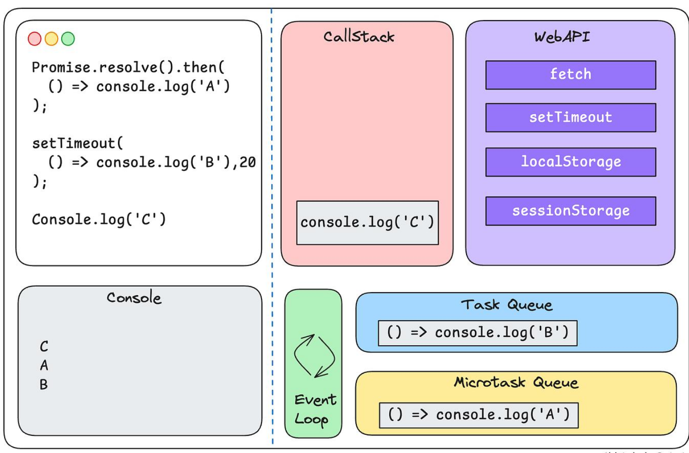

# JavaScript Promises

A **JavaScript Promise** is an object representing the eventual completion or failure of an asynchronous operation.

It serves as a placeholder for a value that is not necessarily known when the promise is created, allowing you to handle asynchronous operations like API requests or file loading without blocking the main execution thread.

---

## 1. The Three States of a Promise

A promise always exists in one of three mutually exclusive states:

- **Pending:** The initial state; the asynchronous operation is still running.
- **Fulfilled:** The operation completed successfully, and a resolved value or data is available.
- **Rejected:** The operation failed, and an error or rejection reason is provided.

Once a promise transitions from `pending` to either `fulfilled` or `rejected`, it is considered **settled**.

A settled promise's state cannot change.

---

## 2. Creating and Consuming a Basic Promise

You construct a promise using the `new Promise()` constructor, which takes an executor callback function with two arguments:

- `resolve` – Called when the asynchronous operation succeeds.
- `reject` – Called when the asynchronous operation fails.

### Example

```javascript
// 1. Creating a Promise
const fetchUserData = new Promise((resolve, reject) => {
  let success = true; // Simulating an operation outcome

  setTimeout(() => {
    if (success) {
      resolve({ id: 1, name: "Alex" });
    } else {
      reject("Failed to fetch user data.");
    }
  }, 1000);
});

// 2. Consuming a Promise
fetchUserData
  .then((data) => {
    console.log("Success:", data);
  })
  .catch((error) => {
    console.error("Error:", error);
  })
  .finally(() => {
    console.log("Operation complete.");
  });
```

### Understanding the handlers

| Method       | Purpose                                                              |
| ------------ | -------------------------------------------------------------------- |
| `.then()`    | Executes when the promise is fulfilled.                              |
| `.catch()`   | Executes when the promise is rejected.                               |
| `.finally()` | Executes regardless of whether the promise is fulfilled or rejected. |

---

## 3. Promise Chaining

To execute multiple asynchronous operations sequentially, you can chain `.then()` methods.

When a handler inside `.then()` returns a value or another promise, that result is passed down to the subsequent `.then()` in the chain.

A single `.catch()` at the bottom can handle rejections from any previous step in the chain.

### Example

```javascript
getUser(1)
  .then((user) => getOrders(user.id)) // Returns a new promise
  .then((orders) => getReceipt(orders[0])) // Returns a new promise
  .then((receipt) => console.log(receipt))
  .catch((err) => console.error(err)); // Handles errors from previous steps
```

### Important points

1. Each `.then()` returns a new promise.
2. Returning a normal value from `.then()` passes that value to the next `.then()`.
3. Returning another promise makes the next `.then()` wait for that promise to settle.
4. Throwing an error inside `.then()` rejects the promise returned by that `.then()`.
5. A `.catch()` can handle errors originating from anywhere earlier in the chain.

---

## 4. Advanced Promise Combinators (Concurrency Methods)

JavaScript provides built-in static methods to manage multiple promises simultaneously.

| Method                      | What it does                            | Behaviour                                                                |
| --------------------------- | --------------------------------------- | ------------------------------------------------------------------------ |
| `Promise.all([...])`        | Waits for all promises to fulfill.      | Rejects as soon as any input promise rejects.                            |
| `Promise.allSettled([...])` | Waits for all promises to settle.       | Returns an array containing the outcome of every promise.                |
| `Promise.race([...])`       | Waits for the first promise to settle.  | Adopts the outcome (fulfilled or rejected) of the first settled promise. |
| `Promise.any([...])`        | Waits for the first successful promise. | Rejects with an `AggregateError` only if all input promises reject.      |

### Quick comparison

- **Promise.all:** I need all operations to succeed.
- **Promise.allSettled:** I need the outcome of every operation, regardless of success or failure.
- **Promise.race:** I need whichever operation settles first.
- **Promise.any:** I need the first successful result.

---

## 5. Modern Alternative: Async / Await

Built on top of promises, `async` and `await` provide cleaner syntax for writing asynchronous code.

They make asynchronous code look and behave more like synchronous code.

### Example

```javascript
async function displayData() {
  try {
    const user = await fetchUserData;

    console.log(user);
  } catch (error) {
    console.error(error);
  }
}
```

### Understanding Async / Await

- An `async` function always returns a Promise.
- `await` pauses execution of the surrounding async function until the promise settles.
- If the promise fulfills, `await` returns its resolved value.
- If the promise rejects, `await` throws the rejection reason.
- Standard `try/catch` blocks can handle rejected promises.

**Important:** `await` does not block the JavaScript main thread. It suspends the execution of the async function while allowing other JavaScript work to continue.

---

## Q) The bigger picture – how Promises fit into JavaScript execution

## A)

Consider this code:

```JSX
console.log("1. Application started");

const userPromise = fetchUser();

console.log("2. Fetch user called");

userPromise.then((user) => {
    console.log("5. User received:", user);
});

console.log("3. Continuing with other work");

function fetchUser() {
    return new Promise((resolve, reject) => {
        console.log("4. Promise executor running");

        setTimeout(() => {
            console.log("6. API response received");

            resolve({ id: 1, name: "Alex" });
        }, 2000);
    });
}
```

**Console o/p**:

1. Application started
2. Promise executor running
3. Fetch user called
4. Continuing with other work

(2 seconds later...)

6. API response received
7. User received: { id: 1, name: "Alex" }

Notice something interesting: **Step 5 executes after Step 6, even though the _.then()_ was registered before the timeout completed.**

Let's understand why.

### Step-by-step execution sequence

# JavaScript Promises – Step-by-Step Execution

## JavaScript execution timeline

| Step                                            | Execution sequence                                                                                        | Corresponding code                              |
| ----------------------------------------------- | --------------------------------------------------------------------------------------------------------- | ----------------------------------------------- |
| **1. Synchronous execution starts**             | JavaScript starts executing the code from top to bottom.                                                  | `console.log("1. Application started");`        |
| **2. `fetchUser()` is invoked**                 | A new Promise is created. Its executor function runs immediately (synchronously).                         | `const userPromise = fetchUser();`              |
| **3. Promise executor runs**                    | The executor function executes immediately when `new Promise()` is created.                               | `console.log("4. Promise executor running");`   |
| **4. Timer is scheduled**                       | `setTimeout` registers a callback with the runtime environment. JavaScript does not wait for two seconds. | `setTimeout(() => { ... }, 2000);`              |
| **5. Promise is returned**                      | The Promise is still pending. Execution continues with the next statement.                                | `console.log("2. Fetch user called");`          |
| **6. `.then()` registers a handler**            | The callback is attached to the pending Promise. It does not execute yet.                                 | `userPromise.then((user) => { ... });`          |
| **7. Remaining synchronous code executes**      | JavaScript continues executing without waiting for the timer.                                             | `console.log("3. Continuing with other work");` |
| **8. Timer expires after two seconds**          | The timer callback executes and logs the API response.                                                    | `console.log("6. API response received");`      |
| **9. Promise is fulfilled**                     | `resolve()` changes the Promise state from `pending` to `fulfilled`.                                      | `resolve({ id: 1, name: "Alex" });`             |
| **10. Promise reaction enters Microtask Queue** | The registered `.then()` callback becomes eligible to execute as a microtask.                             | The callback registered in `.then()` is queued. |
| **11. Event loop processes the microtask**      | Once the current JavaScript execution finishes, the `.then()` callback executes.                          | `console.log("5. User received:", user);`       |

## Complete code once more

```javascript
console.log("1. Application started");

const userPromise = fetchUser();

console.log("2. Fetch user called");

userPromise.then((user) => {
  console.log("5. User received:", user);
});

console.log("3. Continuing with other work");

function fetchUser() {
  return new Promise((resolve, reject) => {
    console.log("4. Promise executor running");

    setTimeout(() => {
      console.log("6. API response received");

      resolve({ id: 1, name: "Alex" });
    }, 2000);
  });
}
```

## Expected console output

```text
1. Application started
4. Promise executor running
2. Fetch user called
3. Continuing with other work

(After approximately 2 seconds)

6. API response received
5. User received: { id: 1, name: "Alex" }
```



## Four Important Components of JavaScript Asynchronous Execution

| Component                        | Responsibility                                                     |
| -------------------------------- | ------------------------------------------------------------------ |
| **Call Stack**                   | Executes synchronous JavaScript code.                              |
| **Runtime APIs**                 | Handles operations such as timers and network requests.            |
| **Microtask Queue**              | Holds Promise reaction callbacks such as `.then()` and `.catch()`. |
| **Task Queue (Macrotask Queue)** | Holds callbacks such as `setTimeout` and DOM events.               |

### Let's prove that Microtasks execute before setTimeout

This is a very useful example to remember.

```JS
console.log("Start");

setTimeout(() => {
    console.log("Timeout callback");
}, 0);

Promise.resolve().then(() => {
    console.log("Promise callback");
});

console.log("End");
```

**Output:**
Start
End
Promise callback
Timeout callback

Why?

1. Start executes synchronously.
2. setTimeout schedules a timer callback.
3. Promise.resolve() creates an already fulfilled Promise.
4. .then() schedules its callback in the microtask queue.
5. End executes synchronously.
6. The call stack becomes empty.
7. The event loop processes the Promise microtask first.
8. The timer callback executes afterwards.
   Even though the timeout is 0, its callback does not execute immediately.

## Important concepts to remember

1. **Promise executor:** Runs immediately and synchronously when `new Promise()` is created.
2. **setTimeout:** Schedules a callback with the runtime environment; it does not block JavaScript execution.
3. **.then():** Registers a callback. The callback runs later as a microtask when the Promise is fulfilled.
4. **resolve():** Changes the Promise state and schedules its registered fulfillment handlers.
5. **Microtask Queue:** Promise reactions are processed after the current synchronous execution finishes, before the next task is processed.

**Big picture:** JavaScript doesn't wait for the asynchronous operation to finish. It continues executing other code and comes back to the Promise handler when the operation completes.
