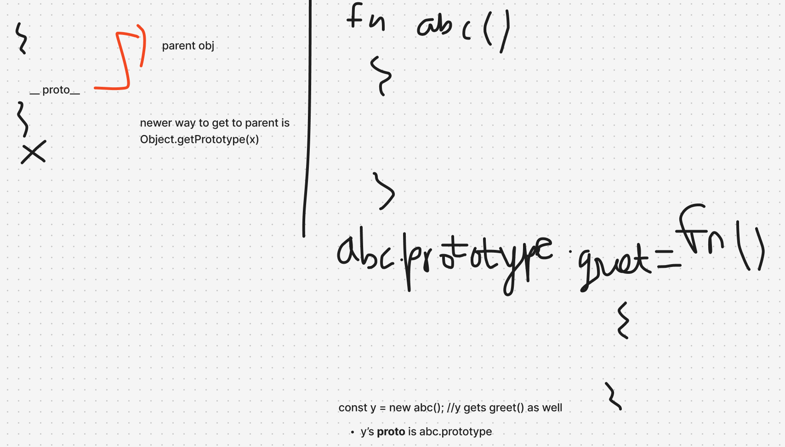

# JavaScript: `prototype` vs `__proto__`

| Concept                      | What it is                                                      | Where it exists                                                                                                                                                                                                                                                                                                                                                                                                                                                                                                                              | Purpose / behaviour                                                                                                                                                                                                                                                                                                                                                                                                                                        |
| ---------------------------- | --------------------------------------------------------------- | -------------------------------------------------------------------------------------------------------------------------------------------------------------------------------------------------------------------------------------------------------------------------------------------------------------------------------------------------------------------------------------------------------------------------------------------------------------------------------------------------------------------------------------------- | ---------------------------------------------------------------------------------------------------------------------------------------------------------------------------------------------------------------------------------------------------------------------------------------------------------------------------------------------------------------------------------------------------------------------------------------------------------- |
| `prototype`                  | - A regular property on certain function objects                | 1) Constructor functions and classes; not arrow functions, async functions, or concise methods <br> 2) specific property found on functions (with a few exceptions like arrow functions) <br> 3) A property that exists only on function objects. **blueprint or template** when that function is invoked as a constructor using the **new keyword** (assigning its properties to the newly created instance's proto). <br>4) Arrow functions, async functions, and methods defined with concise syntax _do not have a .prototype property._ | 1) Acts as the prototype object assigned to instances created with `new` <br> 2)prototypal inheritance itself applies to all objects via their internal [[Prototype]] link (accessible in code via _proto_ or _Object.getPrototypeOf())_. <br> 3): _An internal link that every object has_ (whether created via an object literal {}, Object.create(), or a constructor function). It points to the object it inherits from, forming the prototype chain. |
| `__proto__`                  | A legacy accessor for an object's internal `[[Prototype]]` link | Available on ordinary objects through `Object.prototype` (with exceptions, such as null-prototype objects)                                                                                                                                                                                                                                                                                                                                                                                                                                   | Gets or sets the object that the current object inherits from                                                                                                                                                                                                                                                                                                                                                                                              |
| `[[Prototype]]`              | An internal object link, not an ordinary JavaScript property    | Objects that participate in prototype inheritance                                                                                                                                                                                                                                                                                                                                                                                                                                                                                            | Links an object to its prototype, forming the prototype chain                                                                                                                                                                                                                                                                                                                                                                                              |
| `Object.getPrototypeOf(obj)` | A standard method                                               | `Object`                                                                                                                                                                                                                                                                                                                                                                                                                                                                                                                                     | Returns `obj`'s internal `[[Prototype]]` link without relying on `__proto__`                                                                                                                                                                                                                                                                                                                                                                               |

## Important nuance: two different concepts

- **The `.prototype` property:** A property on constructable functions. When a function is called with `new`, the new object's internal `[[Prototype]]` link is set to that function's `.prototype` object.
- **The `[[Prototype]]` link:** The internal link an object uses to inherit from another object. It can be inspected with `Object.getPrototypeOf(obj)`. The legacy `obj.__proto__` accessor often exposes the same link, but `Object.getPrototypeOf()` is preferred.

## Example

```js
function Person(name) {
  this.name = name;
}

const person = new Person("Alex");

console.log(Person.prototype === Object.getPrototypeOf(person)); // true
console.log(person.__proto__ === Person.prototype); // true (legacy accessor)
```

**Remember:** `Person.prototype` is a property on the constructor function; `person`'s `[[Prototype]]` is the link from the created object to that prototype object.

### How They Relate

When you write `new MyFunction()`, JavaScript takes `MyFunction.prototype` and assigns it as the internal `[[Prototype]]` of the newly minted object.

However, you can have a full prototype chain between plain objects **without ever directly interacting with a function's `.prototype` property**:

```javascript
const parent = {
  greet: () => console.log("Hello!"),
};

const child = Object.create(parent);

child.greet();
// Works via prototypal inheritance, even though no custom function .prototype was used!
```

### Why "only on function objects"?

Because `.prototype` is a special property used by the `new` operator.

**Example:**

```javascript
function A() {}

const obj = {};

console.log(A.prototype); // exists
console.log(obj.prototype); // undefined
```

**Memory:**
A (function)
└── prototype ---> {}

obj (regular object)
└── no prototype property
<br>
**Regular objects** still have a [[Prototype]]:
<br>
**Think of it this way:**

Function
├─ has .prototype
└─ has [[Prototype]]

Regular Object
├─ no .prototype
└─ has [[Prototype]]


